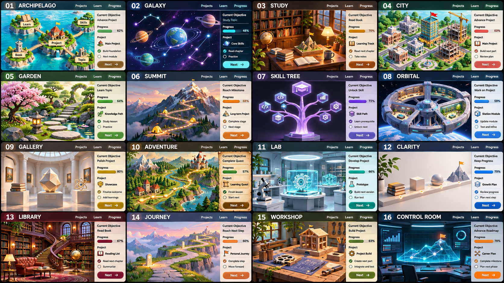

# 16 визуальных направлений

Концепты для сравнения, не готовые экраны приложения. Нумерация слева направо, сверху вниз. Можно соединять идеи нескольких вариантов.

[Промпт генерации](design-prompt.md). Создано встроенным image_gen. Английские надписи в коллаже служат для сравнения концепций и не определяют язык будущего приложения.

| № | Направление | Как это связано с целями |
|---|---|---|
| 01 | Архипелаг | Направления — острова, этапы — мосты между ними |
| 02 | Галактика | Проекты — планеты, навыки — созвездия |
| 03 | Личный кабинет | Книги на полке, проекты на столе, карта на стене |
| 04 | Город | Каждый завершённый проект развивает здание или квартал |
| 05 | Сад | Темы и проекты растут по мере выполнения |
| 06 | Восхождение | Дедлайн — вершина, этапы — лагеря на маршруте |
| 07 | Дерево навыков | Темы связаны зависимостями и открывают следующие узлы |
| 08 | Космическая станция | Разные сферы — модули одной станции |
| 09 | Музей достижений | Законченные проекты становятся экспонатами |
| 10 | Карта приключения | Задачи — квесты, крупные результаты — главы путешествия |
| 11 | Лаборатория | Проекты — эксперименты на рабочих станциях |
| 12 | Спокойный 3D-интерфейс | Понятная структура с объёмными объектами и умеренной анимацией |
| 13 | Библиотека | Книги и темы организованы в трёхмерном пространстве |
| 14 | Маршрут | Вехи расположены вдоль пути к конечной цели |
| 15 | Мастерская | Проекты представлены собираемыми механизмами и моделями |
| 16 | Центр управления | Общая карта, сроки и текущий фокус вокруг 3D-модели |

При выборе стоит оценить не только внешний вид, но и то, насколько быстро получается понять текущий приоритет и открыть нужный объект.
